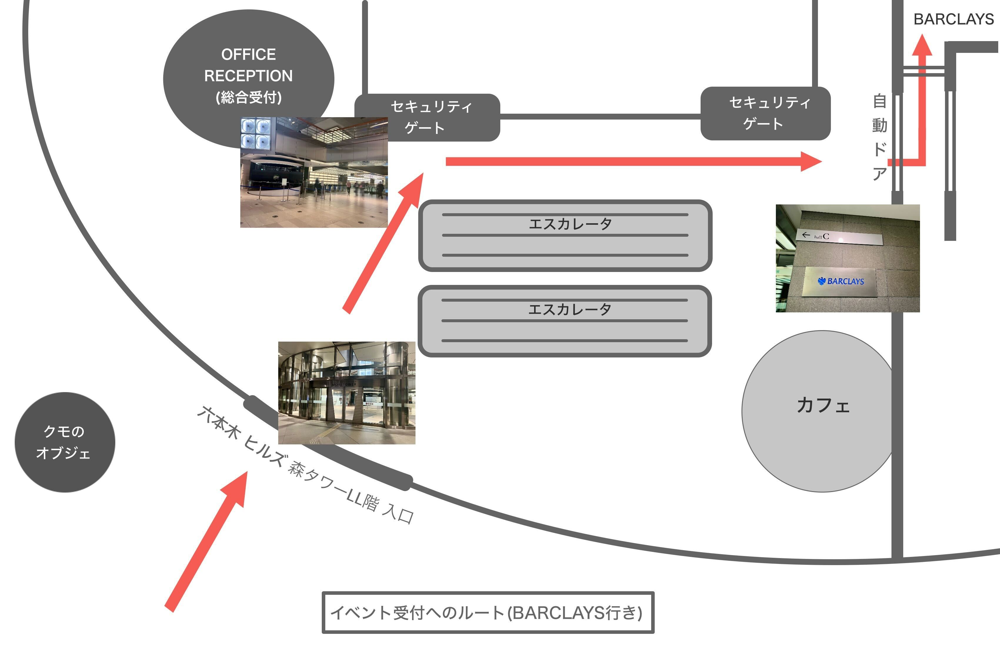

# AI駆動開発 Women's Party【Women's Base 1周年記念】

## 今回のテーマ

<h5><b>AI駆動開発 Women's Party は、AI駆動開発勉強会 Women's Base 1周年を記念して開催するイベントです</b></h5>

1周年を機に、AI駆動開発や技術コミュニティに参加する女性をもっと増やしたい。 
その思いから、今回は複数の女性コミュニティとコラボして、AI駆動開発に興味がある女性同士で交流しながら学びを共有するイベントを開催します！ 

コミュニティに初めて参加する女性も大歓迎です。 
「コミュニティってどんな雰囲気？」「初参加でも大丈夫？」「参加するメリットって？」という方に向けて、コミュニティとの出会いで人生が変わった人たちによるパネルディスカッションも開催します。

セッション終了後は、そのまま会場で懇親会を行います。 
登壇者、参加者、運営メンバー、そして他の女性コミュニティの方々と、ぜひゆっくり交流してください！

AI駆動開発をすでに楽しんでいる方も、これからAIツールに触れてみたい方も、コミュニティ参加の最初の一歩を踏み出したい方も、ぜひお気軽にご参加ください。 

### 日時
<b>2026年5月24日(日) 14:00〜17:30（開場：13:30）</b> 

<b>【重要】遅刻厳禁です！運営メンバーもできる限りセッションを聞けるようにしたいので、ご協力をお願いいたします！迷ったなどのいかなる理由でも14:00以降は入場できません。全員がボランティアでやっている無償のコミュニティのためご了承ください。14時以降、ビルのスタッフの方への問い合わせもお控えください。</b>

### 会場
<b>株式会社メルカリ</b> 
東京都港区六本木6-10-1（六本木ヒルズ森タワー 26F） 
最寄駅：東京メトロ日比谷線・都営大江戸線「六本木駅」

**■ イベント受付**  
イベントの受付場所は、六本木ヒルズ森タワーLL階 Cホール（Barclays入口）です。

LL階の入口は、クモのオブジェが目印になっています。
総合受付を正面に見て、セキュリティゲート手前から右へ進み、自動ドアを1つ通過後、左折した先にあります。
詳細は下記の画像をご参照ください。

### 開催形式
<b>オンサイト・女性限定</b> 

### プログラム
| 時間 | セッション内容 | 発表者 |
| --- | --- | --- |
| 13:30-14:00 | 受付 | |
| 14:00-14:10 | オープニング | 運営 |
| 14:10-14:25 | AI駆動開発セッション | 北川杏子さん(CWBJ) |
| 14:25-14:40 | AI駆動開発セッション | yuuukaさん(PyLadies Tokyo) |
| 14:40-14:55 | (仮) Geek Women の育ち方 〜コミュニティと AI と〜 | chicacoさん（WAKE Communityエバンジェリスト） |
| 14:55-15:10 | AI駆動開発セッション | シータさん（Women AI Initiative Japan） |
| 15:10-15:20 | バッファ | |
| 15:20-16:00 | パネルディスカッション「コミュニティで人生が変わった人たちによる、コミュニティの良さや楽しみ方を語りつくすタイム！」 | ぷにこさん(CWBJ) だむはさん(WAKE Career) オリビアさん(JAZUG for Women) 國本チェルシーさん(Women AI Initiative Japan) |
| 16:00-17:30 | 懇親会 |  |

※プログラム・時間は変更の場合があります。予めご了承ください。 

**■ステッカーコーナー設置**  
共催コミュニティ以外でも、コミュニティのステッカーを配布したい方がいらっしゃいましたらぜひお持ちください。
参加者の方がコミュニティを知るきっかけにしていただければと思っています。    
※持ってきたステッカーが余った場合は、持参した方が責任をもってお持ち帰りください

#### AI駆動開発セッション × 4

各共催女性コミュニティ代表者による、コミュニティ紹介とAI駆動開発に関連するセッションを行います。 

#### パネルディスカッション「コミュニティで人生が変わった人たちによる、コミュニティの良さや楽しみ方を語りつくす会」

複数の女性コミュニティのメンバーが登壇し、コミュニティに参加して良かったこと、楽しみ方、最初の一歩の踏み出し方、そしてコミュニティとの出会いによって変わったことを語り合います。 
「コミュニティってどんなところ？」「自分が行っても大丈夫？」という方も、是非ここで聞いた内容をこの日の懇親会で実践・体験してみましょう！ 

#### 懇親会

セッション終了後、そのまま会場で懇親会を行います。登壇者・参加者・運営メンバー・各コミュニティの方々と交流しましょう！

### 会場＆懇親会スポンサー： **株式会社メルカリ** 様

 

### 共催コミュニティ

- [CWBJ](https://www.microsoft.com/ja-jp/codewithoutbarriers/)
- [PyLadies Tokyo](https://tokyo.pyladies.com/)
- [WAKE 技術とキャリアを磨く 学びのラボ](https://wake-career.jp/)
- [Women AI Initiative Japan](https://women-ai-initiative.jp/)
- [JAZUG (Japan Azure User Group) for Women](https://jazug.connpass.com/)

### 主催者情報
主催：AI駆動開発勉強会 運営委員会 
会場・懇親会協力：株式会社メルカリ